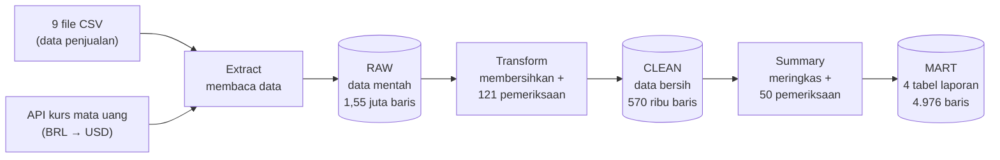

# Olist Batch Pipeline — Dari Data Mentah Menjadi Laporan Siap Pakai

Proyek ini mengolah **±100 ribu transaksi belanja online** dari marketplace Brasil (Olist) yang awalnya berupa
file mentah yang berantakan, menjadi tabel laporan yang **bersih, terverifikasi, dan siap dianalisis**, cukup
dengan satu perintah dan dalam waktu sekitar satu menit.

**Dibuat oleh Rizky Ramdhani** · [LinkedIn](https://www.linkedin.com/in/rizky-ramdhani-302726364) · [kontaknyakiki@gmail.com](mailto:kontaknyakiki@gmail.com)

> **Ringkasan singkat**
>
> - **Peran yang dipraktikkan:** Data Engineer, yaitu orang yang membangun "jalur pipa" agar data mengalir dari sumber
>   ke laporan dengan rapi dan bisa dipercaya.
> - **Yang dibangun:** pipeline otomatis yang membaca 9 file data + 1 sumber online (kurs mata uang),
>   membersihkannya, lalu menyimpannya ke database dalam 3 tahap (mentah → bersih → ringkasan).
> - **Skala:** 1,55 juta baris data mentah → 570 ribu baris bersih → 4.976 baris laporan, selesai dalam **±62 detik**.
> - **Kualitas:** 171 pemeriksaan otomatis setiap kali dijalankan, 72 automated test, dan pengecekan ulang hasil
>   dengan metode kedua yang independen. Hasilnya **cocok 100%**, dengan selisih total pendapatan R$ 0,00.
> - **Teknologi:** Python (pandas), PostgreSQL, SQL, REST API, pytest.

---

## Daftar Isi

1. [Masalah apa yang diselesaikan?](#1-masalah-apa-yang-diselesaikan)
2. [Cara kerjanya (versi sederhana)](#2-cara-kerjanya-versi-sederhana)
3. [Apa saja yang "dibersihkan"?](#3-apa-saja-yang-dibersihkan)
4. [Hasil: apa yang bisa kita pelajari dari datanya?](#4-hasil-apa-yang-bisa-kita-pelajari-dari-datanya)
5. [Bagaimana saya tahu hasilnya benar?](#5-bagaimana-saya-tahu-hasilnya-benar)
6. [Teknologi yang dipakai](#6-teknologi-yang-dipakai)
7. [Cara menjalankan proyek ini](#7-cara-menjalankan-proyek-ini)
8. [Pelajaran yang saya dapat](#8-pelajaran-yang-saya-dapat)
9. [Struktur folder & dokumen teknis](#9-struktur-folder--dokumen-teknis)
10. [Glosarium: istilah yang sering muncul](#10-glosarium-istilah-yang-sering-muncul)
11. [Tentang saya](#11-tentang-saya)

---

## 1. Masalah apa yang diselesaikan?

Bayangkan kamu bekerja di sebuah toko online dan atasan bertanya:

- *"Kategori produk apa yang paling laris?"*
- *"Di provinsi mana pengiriman kita paling lambat?"*
- *"Apakah paket yang telat membuat pelanggan kecewa?"*

Datanya sebenarnya ada, tapi tersebar di **9 file terpisah** (pesanan, barang, pembayaran, ulasan, produk,
penjual, pelanggan, lokasi, dan terjemahan kategori) dan **tidak rapi**. Contohnya:

| Masalah di data mentah | Contoh nyata dari dataset ini |
|---|---|
| Data ganda | 261.831 baris lokasi tercatat dua kali atau lebih |
| Tanggal yang tidak masuk akal | 166 paket "diserahkan ke kurir" **sebelum** barangnya dibeli |
| Penulisan tidak seragam | Kota São Paulo ditulis `são paulo`, `sao paulo`, bahkan `sa£o paulo` (karakter rusak) |
| Data kosong | 610 produk tidak punya kategori |
| Mata uang lokal saja | Semua harga dalam Real Brasil (BRL), tanpa nilai dalam Dolar AS |

Kalau data seperti ini langsung dipakai untuk laporan, angkanya bisa **salah tanpa ada yang sadar**.
Proyek ini membangun proses otomatis yang merapikan semua itu, sehingga siapa pun bisa langsung menjawab
pertanyaan bisnis di atas dengan satu query sederhana.

---

## 2. Cara kerjanya (versi sederhana)

Analogi yang paling mudah: **dapur restoran**.

| Tahap di dapur | Tahap di pipeline | Penjelasan |
|---|---|---|
| Bahan datang dari pemasok | **Extract** | Membaca 9 file CSV dan mengambil kurs BRL→USD harian dari internet (API) |
| Bahan disimpan di gudang apa adanya | **Layer `raw`** (mentah) | Salinan persis data asli. Kalau ada kesalahan di tahap berikutnya, kita cukup mengulang dari sini |
| Bahan dicuci, dipotong, yang busuk dibuang | **Layer `clean`** (bersih) | Data dirapikan, diperbaiki, dan diperiksa dengan 121 aturan kualitas |
| Hidangan siap saji | **Layer `mart`** (ringkasan) | 4 tabel laporan yang siap dipakai analis atau dashboard |



Seluruh proses dijalankan dengan **satu perintah** (`python main.py`). Jika ada satu saja pemeriksaan kualitas
yang gagal, pipeline **berhenti** sebelum menyimpan apa pun, sehingga laporan lama tidak tertimpa data yang salah.

Contoh ringkasan yang muncul di layar setelah pipeline selesai:

```text
RINGKASAN RUN
  Cek koneksi database                    0.3 detik
  Extract (CSV + API)                     4.0 detik
  Load raw                                7.2 detik
  Transform + quality check clean         8.7 detik
  Load clean                             40.4 detik
  Summary + rekonsiliasi mart             1.0 detik
  Load mart                               0.2 detik
  TOTAL                                  62.1 detik
  Baris dimuat: raw 1,551,471 | clean 570,460 | mart 4,976
Pipeline SUKSES
```

### Empat tabel laporan yang dihasilkan

| Tabel | Menjawab pertanyaan |
|---|---|
| `mart.daily_sales` | Berapa pesanan dan pendapatan setiap hari (dalam BRL dan USD)? |
| `mart.monthly_category_sales` | Kategori produk apa yang paling laku setiap bulan? |
| `mart.seller_performance` | Penjual mana yang paling laris, paling cepat mengirim, dan paling disukai pembeli? |
| `mart.state_delivery_summary` | Bagaimana kecepatan pengiriman dan kepuasan pelanggan di setiap negara bagian? |

---

## 3. Apa saja yang "dibersihkan"?

Sebelum menulis kode, saya **memeriksa data terlebih dahulu** (istilahnya *profiling*) untuk menemukan
kejanggalan. Setiap kejanggalan lalu diputuskan dengan satu dari empat tindakan:

| Tindakan | Kapan dipakai | Contoh |
|---|---|---|
| **Perbaiki** | Nilai yang benar bisa dipastikan | Pembayaran dengan "0 kali cicilan" → diperbaiki jadi 1 kali (bayar lunas) |
| **Kosongkan satu kolom** | Hanya satu kolom yang salah, sisa datanya masih berguna | Tanggal serah ke kurir yang lebih awal dari tanggal beli → tanggal itu dikosongkan, pesanannya tetap disimpan |
| **Buang baris** | Datanya bertentangan dan akan merusak perhitungan | 64 ulasan yang ditulis **sebelum** barangnya dibeli |
| **Biarkan** | Nilainya ekstrem tapi masih mungkin terjadi | Pengiriman yang memakan waktu 209 hari: aneh, tapi bukan mustahil |

Poin terakhir penting: **data yang tidak biasa belum tentu data yang salah.** Membuang data yang sebenarnya valid
sama berbahayanya dengan menyimpan data yang salah.

Beberapa perbaikan lain yang dilakukan:

- **Kode pos tetap utuh.** Kode pos seperti `01037` mudah berubah menjadi `1037` kalau dibaca sebagai angka.
  Karena itu semua data dibaca sebagai teks terlebih dahulu.
- **Nama kota diseragamkan.** Huruf kecil, tanpa aksen, tanpa karakter rusak (`são paulo`, `sa£o paulo` → `sao paulo`).
  Ada 2.085 variasi penulisan kota yang dirapikan.
- **1 juta baris lokasi → 19.010 baris.** Satu kode pos semula punya ratusan titik koordinat. Setiap kode pos
  disederhanakan menjadi satu titik tengah.
- **Kurs di hari libur.** Bank tidak menerbitkan kurs pada akhir pekan, jadi dipakai kurs hari kerja terakhir
  dan baris tersebut diberi tanda.
- **Kolom baru yang berguna.** Contohnya lama pengiriman (hari), apakah paket telat, total nilai barang + ongkir,
  dan pendapatan dalam USD.

Daftar lengkap aturan beserta jumlah data yang terdampak ada di [specs/requirements.md](specs/requirements.md).

---

## 4. Hasil: apa yang bisa kita pelajari dari datanya?

Setelah data bersih, pertanyaan bisnis bisa dijawab dengan query singkat ke tabel `mart`.
Berikut beberapa temuan dari data penjualan **4 September 2016 – 3 September 2018**:

**Gambaran umum:** 98.199 pesanan dengan total pendapatan **R$ 15,74 juta (± US$ 4,69 juta)**.

### Temuan 1 — Black Friday adalah hari tersibuk sepanjang dua tahun

| Tanggal | Pesanan | Pendapatan (BRL) |
|---|---:|---:|
| **24 Nov 2017 (Black Friday)** | **1.166** | **178.377,63** |
| 25 Nov 2017 | 498 | 71.858,16 |
| 27 Nov 2017 | 400 | 56.644,85 |

Pada Black Friday, jumlah pesanan **lebih dari 2× lipat** hari tersibuk berikutnya dan sekitar **7× lipat** rata-rata
harian (±160 pesanan). Pendapatan November 2017 naik **53%** dibanding Oktober. Bagi bisnis, ini berarti stok dan
kapasitas pengiriman perlu disiapkan jauh sebelum November.

```sql
SELECT sales_date, total_orders, total_revenue_brl
FROM mart.daily_sales
ORDER BY total_orders DESC
LIMIT 3;
```

### Temuan 2 — Paket yang telat membuat nilai ulasan anjlok

| Status pengiriman | Jumlah pesanan | Rata-rata bintang | Ulasan buruk (1–2 bintang) |
|---|---:|---:|---:|
| Tepat waktu | 89.440 | **4,29** ⭐ | 9,3% |
| Terlambat | 6.381 | **2,27** ⭐ | **62,4%** |

Hanya 6,8% paket yang terlambat, tapi **6 dari 10** pembeli yang paketnya terlambat memberi ulasan buruk.
Artinya, ketepatan waktu pengiriman sangat menentukan kepuasan pelanggan.

### Temuan 3 — Lokasi pembeli sangat memengaruhi pengalaman belanja

| Negara bagian | Pesanan | Rata-rata lama kirim | Paket telat | Rata-rata bintang |
|---|---:|---:|---:|---:|
| São Paulo (SP) | 41.125 | **8,7 hari** | 4,5% | 4,21 |
| Rio de Janeiro (RJ) | 12.697 | 15,2 hari | 12,1% | 3,91 |
| Alagoas (AL) | 411 | 24,5 hari | **21,4%** | 3,76 |
| Roraima (RR) | 45 | **29,3 hari** | 12,2% | **3,64** |

Pembeli di São Paulo (pusat bisnis Brasil) menerima paket **3× lebih cepat** dibanding pembeli di Roraima di
wilayah utara. Wilayah yang paketnya sering telat juga cenderung memberi nilai ulasan lebih rendah.

```sql
SELECT customer_state, total_orders, avg_delivery_days, late_delivery_rate, avg_review_score
FROM mart.state_delivery_summary
ORDER BY avg_delivery_days;
```

### Temuan 4 — Kategori terlaris dan penjual terbesar

| Kategori | Pesanan | Pendapatan (BRL) |
|---|---:|---:|
| Kesehatan & kecantikan (`health_beauty`) | 8.800 | 1.437.665,78 |
| Jam tangan & hadiah (`watches_gifts`) | 5.604 | 1.298.292,47 |
| Perlengkapan tidur & mandi (`bed_bath_table`) | 9.399 | 1.240.386,13 |
| Olahraga & hobi (`sports_leisure`) | 7.673 | 1.147.244,63 |
| Komputer & aksesoris (`computers_accessories`) | 6.654 | 1.050.941,58 |

Menariknya, `bed_bath_table` punya pesanan lebih banyak daripada `health_beauty`, tapi pendapatannya lebih kecil.
Artinya, rata-rata nilai belanja per pesanannya lebih rendah. Dari sisi penjual, **10% penjual teratas (305 dari 3.053) menghasilkan 66,6% dari
seluruh pendapatan**, jadi menjaga penjual-penjual besar ini sangat penting bagi marketplace.

```sql
SELECT category_name_english, SUM(total_orders) AS pesanan, SUM(total_revenue_brl) AS pendapatan_brl
FROM mart.monthly_category_sales
GROUP BY category_name_english
ORDER BY pendapatan_brl DESC
LIMIT 5;
```

---

## 5. Bagaimana saya tahu hasilnya benar?

Laporan yang angkanya salah lebih berbahaya daripada tidak ada laporan sama sekali. Karena itu kebenaran hasil
dicek dengan beberapa lapis pemeriksaan:

| Lapis | Apa yang dilakukan | Hasil |
|---|---|---|
| **1. Pemeriksaan otomatis setiap run** | 121 aturan untuk data bersih (contoh: tidak ada ID ganda, nilai bintang harus 1–5, tanggal terima tidak boleh sebelum tanggal beli) + 50 aturan untuk tabel laporan | Semua lolos. Jika satu saja gagal, pipeline berhenti |
| **2. Aturan di database** | Database sendiri menolak data yang melanggar aturan, sebagai jaring pengaman terakhir | Diuji dengan sengaja memasukkan data salah, dan database menolaknya |
| **3. "Semua atau tidak sama sekali"** | Jika penyimpanan gagal di tengah jalan, semua perubahan dibatalkan (*rollback*) | Database tidak pernah berisi data setengah jadi |
| **4. Automated test** | 72 test yang mengecek setiap aturan pembersihan dengan data contoh yang hasilnya sudah dihitung manual | 72/72 lolos, ±16 detik |
| **5. Menguji si pemeriksa** | Kesalahan sengaja disisipkan ke data untuk memastikan pemeriksaan otomatis benar-benar menangkapnya (*mutation test*) | 18/18 kesalahan di data bersih dan 10/10 di laporan tertangkap |
| **6. Dihitung ulang dengan cara lain** | Keempat tabel laporan dihitung ulang dari nol memakai SQL murni ([sql/04_verify.sql](sql/04_verify.sql)), lalu dibandingkan dengan hasil Python | **0 perbedaan**, dan total pendapatan di keempat tabel cocok sampai sen terakhir |
| **7. Uji skenario gagal** | Database mati, password salah, internet putus, data rusak | Pipeline berhenti dengan pesan yang jelas dan data lama tetap utuh |

Logikanya sederhana: kalau dua cara yang berbeda menghasilkan angka yang sama persis, kecil sekali kemungkinan
keduanya salah dengan cara yang sama.

---

## 6. Teknologi yang dipakai

| Teknologi | Apa itu? (penjelasan singkat) | Dipakai untuk |
|---|---|---|
| **Python** | Bahasa pemrograman yang populer untuk mengolah data | Seluruh logika pipeline |
| **pandas** | Library Python untuk mengolah tabel, mirip Excel tapi lewat kode | Membersihkan dan meringkas data |
| **PostgreSQL** | Database, tempat penyimpanan data yang terstruktur dan andal | Menyimpan layer raw, clean, dan mart |
| **SQL** | Bahasa untuk mengambil dan mengolah data di database | Membuat tabel, verifikasi, dan analisis |
| **SQLAlchemy + psycopg** | Penghubung antara Python dan PostgreSQL | Mengirim data ke database |
| **REST API (Frankfurter)** | Layanan online gratis yang menyediakan data kurs mata uang | Mengambil kurs BRL→USD harian |
| **pytest** | Alat untuk menjalankan automated test | 72 test otomatis |

---

## 7. Cara menjalankan proyek ini

> Bagian ini untuk yang ingin mencoba sendiri. Perintah di bawah memakai **Windows (PowerShell)**. Pengguna
> macOS/Linux cukup mengganti `.venv\Scripts\activate` dengan `source .venv/bin/activate` dan `copy` dengan `cp`.

### Yang perlu disiapkan

- **Python** (diuji dengan versi 3.14)
- **PostgreSQL** (diuji dengan versi 18)
- Koneksi internet (untuk mengambil kurs mata uang)

### Langkah-langkah

**1. Unduh dataset.** Unduh [Brazilian E-Commerce Public Dataset by Olist](https://www.kaggle.com/datasets/olistbr/brazilian-ecommerce)
dari Kaggle, lalu ekstrak ke-9 file CSV-nya ke folder `data/`.

**2. Siapkan lingkungan Python** (dijalankan di folder proyek):

```powershell
python -m venv .venv
.venv\Scripts\activate
pip install -r requirements.txt
```

**3. Buat database dan tabel.** Buat database kosong (misalnya bernama `olist`), lalu jalankan file SQL secara berurutan:

```powershell
psql -U postgres -c "CREATE DATABASE olist;"
psql -U postgres -d olist -f sql/00_schemas.sql
psql -U postgres -d olist -f sql/01_raw_tables.sql
psql -U postgres -d olist -f sql/02_clean_tables.sql
psql -U postgres -d olist -f sql/03_mart_tables.sql
```

**4. Atur koneksi database.** Salin file contoh, lalu isi username, password, dan nama database milikmu:

```powershell
copy .env.example .env
```

```text
DATABASE_URI=postgresql://<user>:<password>@localhost:5432/olist
```

File `.env` berisi password, jadi file ini sengaja **tidak ikut di-upload** ke GitHub (diatur di `.gitignore`).

**5. Jalankan pipeline:**

```powershell
python main.py
```

Jika berhasil, baris terakhir di layar akan berbunyi `Pipeline SUKSES`. Pipeline aman dijalankan berulang kali
karena hasilnya selalu sama.

**6. (Opsional) Jalankan test dan verifikasi:**

```powershell
pytest                     # semua 72 test (±16 detik, tanpa database & internet)
pytest -m "not slow"       # versi cepat, tanpa test yang memakai dataset lengkap
psql -U postgres -d olist -f sql/04_verify.sql   # verifikasi hasil langsung di database
```

---

## 8. Pelajaran yang saya dapat

**1. Kenali datanya dulu, baru membersihkan.**
Banyak masalah di dataset ini tidak terlihat sekilas, misalnya paket yang "diterima sebelum dikirim" atau ulasan
yang "ditulis sebelum barang dibeli". Semua itu baru ketahuan setelah data diperiksa secara sistematis. Tanpa tahap
ini, aturan pembersihan hanya akan berdasarkan tebakan.

**2. Data yang aneh belum tentu salah.**
Pengiriman 209 hari terlihat seperti kesalahan, tapi urutan tanggalnya logis. Saya belajar membedakan *outlier*
(tidak biasa, tapi mungkin terjadi) dari data *invalid* (mustahil terjadi), dan mencatat alasan setiap keputusan.

**3. Kesalahan kecil bisa merusak data diam-diam.**
Kode pos `01037` yang berubah menjadi `1037`, atau karakter tersembunyi di awal file yang membuat nama kolom
tidak terbaca. Kesalahan seperti ini tidak memunculkan pesan error, tapi hasilnya salah.

**4. Lebih baik berhenti daripada menghasilkan angka yang salah.**
Pipeline sengaja dibuat "rewel": satu pemeriksaan gagal, semuanya berhenti. Ditambah prinsip "semua atau tidak sama
sekali" saat menyimpan data, laporan yang sudah ada tidak pernah tertimpa data yang rusak.

**5. Pemeriksa juga perlu diperiksa.**
Pemeriksaan otomatis yang selalu "lolos" belum tentu bekerja. Dengan sengaja menyisipkan kesalahan dan memastikan
pemeriksaan menangkapnya, saya jadi yakin pemeriksaan itu benar-benar berfungsi.

**6. Uji juga skenario ketika semuanya berjalan buruk.**
Saat database sengaja dimatikan, pipeline ternyata "menggantung" selama **260 detik** sebelum menyerah. Masalah ini
tidak akan ketahuan kalau saya hanya menguji skenario normal. Setelah diperbaiki, pipeline langsung berhenti dalam
10 detik dengan pesan yang jelas.

**7. Rencanakan sebelum menulis kode.**
Proyek ini dimulai dari tiga dokumen: *apa* yang dibangun ([requirements](specs/requirements.md)), *bagaimana*
membangunnya ([design](specs/design.md)), dan *urutan* pengerjaannya ([tasks](specs/tasks.md)). Setiap keputusan
ditulis beserta alasannya, sehingga mudah ditinjau ulang dan dijelaskan ke orang lain.

### Yang bisa dikembangkan selanjutnya

- Menjalankan pipeline otomatis setiap hari dengan penjadwal (misalnya Airflow).
- Hanya memproses data baru, bukan semua data setiap kali (*incremental load*), untuk data yang terus bertambah.
- Membuat dashboard visual dari tabel `mart`.
- Membungkus database dengan Docker agar proyek bisa dijalankan dengan lebih sedikit langkah.

---

## 9. Struktur folder & dokumen teknis

```text
batch_pipeline_project/
├── main.py            # tombol "start": menjalankan seluruh pipeline
├── config.py          # pengaturan: lokasi file, alamat API, batas validasi
├── extract/           # tahap 1: membaca CSV & mengambil kurs dari API
├── transform/         # tahap 2: membersihkan (transform.py), meringkas (summary.py), memeriksa (quality.py)
├── load/              # tahap 3: menyimpan ke database
├── sql/               # definisi tabel database (00–03) & query verifikasi (04)
├── tests/             # 72 automated test
├── specs/             # dokumen perencanaan: requirements, design, tasks
├── data/              # dataset Kaggle (tidak di-upload, unduh sendiri)
└── .env.example       # contoh pengaturan koneksi database
```

Untuk pembaca teknis, detail lengkap ada di folder [specs/](specs/):

- [requirements.md](specs/requirements.md): profil data, semua aturan pembersihan, dan anomali yang sengaja dipertahankan beserta alasannya.
- [design.md](specs/design.md): arsitektur, diagram tabel (ERD), definisi setiap metrik, dan alasan di balik setiap keputusan teknis.
- [tasks.md](specs/tasks.md): urutan pengerjaan dan bukti verifikasi tiap tahap.

---

## 10. Glosarium: istilah yang sering muncul

| Istilah | Arti sederhana |
|---|---|
| **Pipeline** | Rangkaian langkah otomatis yang memindahkan dan mengolah data dari sumber ke tujuan, seperti jalur pipa |
| **Batch** | Data diproses sekaligus dalam satu kali jalan, bukan satu per satu secara terus-menerus |
| **ETL** | *Extract, Transform, Load*: ambil data, olah, lalu simpan. Tiga tahap inti pipeline ini |
| **Database** | Tempat penyimpanan data yang terstruktur, seperti lemari arsip digital |
| **Schema** | "Laci" di dalam database. Proyek ini memakai 3 laci: `raw`, `clean`, `mart` |
| **CSV** | Format file tabel sederhana yang bisa dibuka di Excel |
| **API** | Pintu yang disediakan sebuah layanan online agar program lain bisa meminta data darinya |
| **Query** | Pertanyaan yang diajukan ke database dalam bahasa SQL |
| **Data quality check** | Pemeriksaan otomatis untuk memastikan data mengikuti aturan yang ditetapkan |
| **Rollback** | Membatalkan semua perubahan jika terjadi kegagalan, sehingga data kembali seperti semula |
| **Automated test** | Program kecil yang mengecek apakah kode bekerja sesuai harapan, tanpa perlu dicek manual |
| **Outlier** | Nilai yang jauh berbeda dari kebanyakan data, tapi belum tentu salah |
| **BRL / R$** | Real Brasil, mata uang yang dipakai di seluruh transaksi dataset ini |

---

## 11. Tentang saya

Halo, saya **Rizky Ramdhani**. Proyek ini adalah bagian dari portofolio saya untuk belajar dan berkarier di bidang
**data engineering**. Saya senang mengubah data yang berantakan menjadi informasi yang bisa dipercaya dan dipakai
untuk mengambil keputusan.

Terbuka untuk kesempatan kerja, kolaborasi, maupun diskusi seputar data. Silakan hubungi saya:

- **LinkedIn:** [linkedin.com/in/rizky-ramdhani-302726364](https://www.linkedin.com/in/rizky-ramdhani-302726364)
- **Email:** [kontaknyakiki@gmail.com](mailto:kontaknyakiki@gmail.com)

---

**Sumber data:** [Brazilian E-Commerce Public Dataset by Olist](https://www.kaggle.com/datasets/olistbr/brazilian-ecommerce)
(Kaggle, lisensi CC BY-NC-SA 4.0) · Kurs mata uang dari [Frankfurter API](https://frankfurter.dev/) (data European Central Bank).
