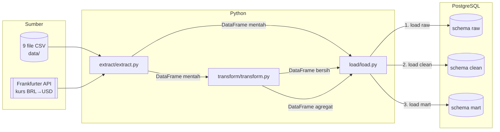
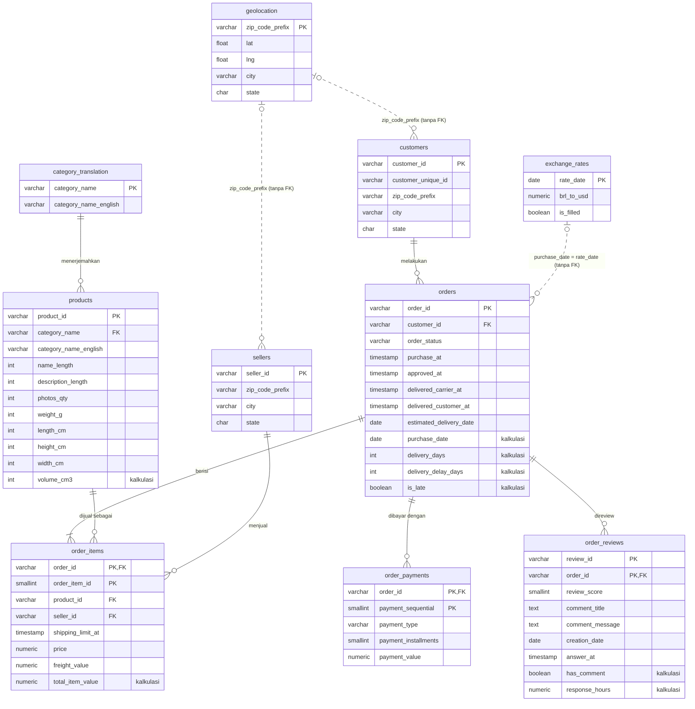
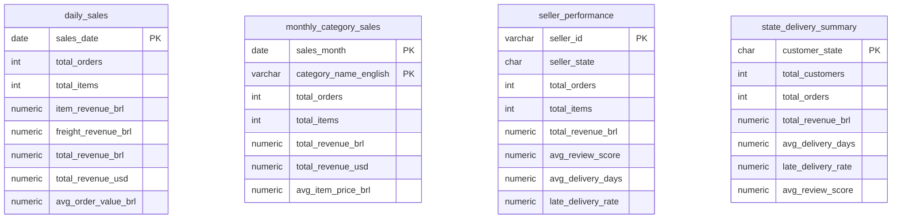

# Design — Olist Batch Pipeline

> Dokumen ini menjawab **"BAGAIMANA"** requirement di [requirements.md](requirements.md) dipenuhi.
> Setiap keputusan desain diberi alasan, karena alasan itulah yang paling berharga untuk dipelajari.

## 1. Arsitektur



Urutan di `main.py`:

```
extract  →  load_raw  →  transform (clean)  →  load_clean  →  transform (summary)  →  load_mart
```

### Keputusan desain

| Keputusan | Alasan |
|---|---|
| **3 layer: raw → clean → mart** (pola *medallion*: bronze/silver/gold) | Raw menyimpan bukti apa yang diterima dari sumber. Kalau ada bug di transform, kita cukup perbaiki dan jalankan ulang tanpa ambil data lagi. Mart memisahkan kebutuhan analis dari detail teknis. |
| **Satu database, tiga schema** (`raw`, `clean`, `mart`) | Pemisahan jelas tanpa repot mengelola banyak database. Hak akses bisa diatur per schema (contoh: analis hanya boleh baca `mart`). |
| **Tabel dibuat eksplisit lewat DDL (`sql/`), bukan dibuat otomatis oleh `pandas.to_sql`** | `to_sql` yang membuat tabel sendiri akan menebak tipe (`TEXT`, `BIGINT`, `DOUBLE`), tidak membuat primary key/foreign key/constraint, dan zip code bisa kehilangan angka nol di depan. DDL eksplisit = **kontrak skema** yang bisa direview dan di-versioning. |
| **Raw: semua kolom `TEXT`** | Layer raw tidak boleh gagal hanya karena satu nilai aneh. Validasi tipe adalah tugas layer clean. |
| **Full refresh (`TRUNCATE` + insert)** | Dataset statis dan kecil (±1,5 juta baris total), jadi full refresh paling sederhana dan otomatis idempotent. Incremental load baru sepadan untuk data yang terus bertambah. |
| **`TRUNCATE` semua tabel satu layer dalam satu statement, tanpa `CASCADE`** | PostgreSQL mengizinkan TRUNCATE tabel induk jika semua tabel anaknya ikut di statement yang sama. `CASCADE` justru berbahaya: tabel lain di luar daftar yang punya FK ke sini akan ikut kosong diam-diam. |
| **Dua lapis validasi: quality check Python + constraint DB** | Quality check memberi laporan lengkap (semua pelanggaran sekaligus, sebelum menyentuh DB). Constraint DB adalah jaring pengaman terakhir jika ada data yang lolos atau ditulis oleh proses lain. |
| **Satu transaksi per layer** | Kalau load clean gagal di tabel ke-7, tabel 1–6 ikut di-rollback. Database tidak pernah berisi data setengah jadi. |
| **Load raw pakai `COPY`, clean/mart pakai `to_sql(if_exists="append")`** | `COPY` adalah cara tercepat memasukkan data massal ke PostgreSQL (penting untuk 1 juta baris geolocation). `append` (bukan `replace`) dipakai agar tabel hasil DDL tidak di-drop oleh pandas. |
| **Transform = pure function** | `def transform_orders(df) -> df`. Tidak ada akses database di dalamnya, sehingga mudah di-unit test. |
| **Mart dihitung di pandas** | Tujuan portofolio adalah menunjukkan kemampuan transformasi Python. (Alternatif yang juga umum di industri: `INSERT ... SELECT` di SQL / dbt.) |

## 2. Struktur Folder

```
batch_pipeline_project/
├── specs/                  # requirements.md, design.md, tasks.md (dokumen ini)
├── sql/                    # DDL — dijalankan manual sekali di DBMS
│   ├── 00_schemas.sql
│   ├── 01_raw_tables.sql
│   ├── 02_clean_tables.sql
│   └── 03_mart_tables.sql
├── data/                   # CSV Kaggle (tidak di-commit)
├── extract/
│   ├── __init__.py
│   └── extract.py          # baca CSV + panggil API
├── transform/
│   ├── __init__.py
│   ├── transform.py        # cleaning + kolom kalkulasi (raw → clean)
│   ├── summary.py          # agregasi (clean → mart)
│   └── quality.py          # data quality check sebelum load (clean & mart)
├── load/
│   ├── __init__.py
│   └── load.py             # koneksi SQLAlchemy + load ke raw/clean/mart
├── tests/                  # unit test fungsi transform (pytest)
├── config.py               # path, daftar file, URL API, batas validasi
├── main.py                 # orkestrator pipeline
├── requirements.txt
├── .env                    # DATABASE_URI (rahasia, tidak di-commit)
├── .env.example            # contoh isi .env (di-commit)
└── .gitignore
```

## 3. Model Data

### 3.1 Layer raw

Satu tabel per sumber, nama kolom **sama persis** dengan header CSV (termasuk typo `lenght`), semua `TEXT`,
ditambah `_loaded_at TIMESTAMPTZ DEFAULT now()`.

| Tabel | Sumber |
|---|---|
| `raw.customers` | `olist_customers_dataset.csv` |
| `raw.geolocation` | `olist_geolocation_dataset.csv` |
| `raw.orders` | `olist_orders_dataset.csv` |
| `raw.order_items` | `olist_order_items_dataset.csv` |
| `raw.order_payments` | `olist_order_payments_dataset.csv` |
| `raw.order_reviews` | `olist_order_reviews_dataset.csv` |
| `raw.products` | `olist_products_dataset.csv` |
| `raw.sellers` | `olist_sellers_dataset.csv` |
| `raw.category_translation` | `product_category_name_translation.csv` |
| `raw.exchange_rates` | Frankfurter API |

### 3.2 Layer clean — ERD



**Kenapa geolocation & exchange_rates tidak pakai foreign key?** Tidak semua zip code customer/seller ada di tabel
geolocation, dan kurs adalah data referensi yang di-join berdasarkan tanggal. Memaksakan FK justru akan membuang
customer yang valid. Relasinya tetap ada secara logika (garis putus-putus), hanya tidak di-enforce database.

### 3.3 Layer mart



Definisi metrik (berlaku untuk semua tabel mart):

- **Order yang dihitung** = `order_status NOT IN ('canceled', 'unavailable')`.
- **Revenue** dihitung dari `order_items` (`price + freight_value`), bukan dari `order_payments`, agar bisa dipecah per
  kategori & seller (payment hanya tercatat per order).
- **Revenue USD** = revenue BRL × `brl_to_usd` pada `purchase_date`.
- **Metrik pengiriman** (`avg_delivery_days`, `late_delivery_rate`) hanya dari order `order_status = 'delivered'`
  yang punya `delivered_customer_at`.
- **`late_delivery_rate`** = jumlah order `is_late = true` / jumlah order pada definisi di atas.
- **Skor review per order** = review **terakhir** (berdasarkan `answer_at`, lalu `creation_date`), karena 547 order
  punya > 1 review dan 202 di antaranya skornya berbeda. Skor terakhir mencerminkan pendapat akhir customer.
- **`avg_review_score`** dihitung per order unik (satu order bisa punya >1 seller, review-nya dihitung untuk setiap seller tersebut).
- **`total_customers`** memakai `customer_unique_id` (satu orang bisa punya beberapa `customer_id`).
- **Cakupan baris**: `daily_sales` hanya berisi tanggal yang ada penjualannya (rata-rata nilai order di hari tanpa
  penjualan tidak terdefinisi); `seller_performance` hanya berisi seller dengan ≥ 1 order penjualan; semua metrik
  `state_delivery_summary` (termasuk review) dihitung dari order penjualan.
- **`total_orders` per kategori / per seller** = jumlah order unik. Karena satu order bisa berisi beberapa kategori
  atau seller, jumlahnya di seluruh baris bisa lebih besar dari total order. Ini wajar, bukan double counting revenue.
- **Pembulatan** mengikuti tipe kolom DDL: uang 2 desimal, rata-rata hari & skor 2 desimal, rate 4 desimal.

**Validasi mart** (`validate_summaries`, Req 10.6–10.7) — rekonsiliasi lintas tabel:

```
SUM(daily.total_revenue_brl) = SUM(monthly_category.total_revenue_brl) = SUM(seller.total_revenue_brl)
  = SUM(state.total_revenue_brl) = SUM(clean.order_items.total_item_value untuk order penjualan)
SUM(daily.total_orders) = SUM(state.total_orders) = jumlah order penjualan
```

## 4. Aturan Transformasi (mapping requirement → implementasi)

| Tabel clean | Duplikat (R4) | Missing value (R5) | Format tanggal & teks (R6) | Kalkulasi (R7) | Filter / koreksi invalid (R8) |
|---|---|---|---|---|---|
| `category_translation` | by PK | tambah terjemahan manual (`pc_gamer`, `portateis_…`, `unknown`); kategori lain tanpa terjemahan → nama asli | – | – | – |
| `geolocation` | drop duplikat penuh, lalu **1 baris per zip**: median lat/lng, city & state terbanyak (*mode*; seri → urut abjad) | – | city dinormalisasi **sebelum** mode, agar `são paulo` & `sao paulo` dihitung sebagai satu kota | – | buang koordinat di luar Brasil: lat −33,75…5,27; lng −73,99…−34,79 |
| `customers`, `sellers` | by PK | – | city dinormalisasi; city invalid → singkatan dikenal (`sbc`) atau kota geolocation dari zip, jika tidak ada → `NULL` | – | – |
| `products` | by PK | kategori kosong → `unknown`; dimensi kosong → tetap `NULL` | rename kolom typo `lenght` → `length` | `volume_cm3` | berat 0 → `NULL` |
| `orders` | by PK | timestamp kosong → tetap `NULL` | 4 kolom → `TIMESTAMP` (`*_at`), estimasi → `DATE` | `purchase_date`, `delivery_days`, `delivery_delay_days`, `is_late` | carrier di luar `[max(purchase, approved), delivered]` → `NULL`; buang jika delivered/approved < purchase; buang order tanpa item yang statusnya bukan `canceled`/`unavailable` |
| `order_items` | by PK | – | `shipping_limit_at` → `TIMESTAMP` | `total_item_value` | `shipping_limit_at` > purchase + 90 hari → `NULL`; buang jika `price <= 0`, `freight_value < 0`, product/seller tidak dikenal, atau order induk dibuang |
| `order_payments` | by PK | – | – | – | buang `payment_value <= 0` & `not_defined`; installments 0 → 1; buang jika order induk dibuang |
| `order_reviews` | by PK `(review_id, order_id)` | komentar kosong/hanya spasi → `NULL` | `creation_date` → `DATE`, `answer_at` → `TIMESTAMP`; spasi komentar dirapikan | `has_comment`, `response_hours` | buang skor di luar 1–5; buang review yang dibuat sebelum order dibeli; buang jika order induk dibuang |
| `exchange_rates` | by PK | **forward fill** setiap tanggal kalender, `is_filled = true` | `rate_date` → `DATE` | – | buang kurs ≤ 0 |

**Normalisasi nama kota** (`normalize_city`), berurutan:
huruf kecil → `´`/`’` jadi `'` → buang aksen (Unicode NFKD) → buang keterangan dalam kurung → ambil bagian sebelum
`/` atau `,` → buang karakter selain `a-z 0-9 ' - .` (membersihkan karakter rusak seperti `£`) → spasi tunggal.
Kota dianggap invalid jika mengandung `@`, seluruhnya angka, atau hanya 2 huruf (kode negara bagian).

**Data quality check** (`transform/quality.py`, Req 8.13). Dijalankan setelah transform dan sebelum load. Isinya
mencerminkan constraint DDL (PK unik, FK, CHECK), ditambah aturan yang tidak bisa ditulis sebagai CHECK karena
melibatkan dua tabel (contoh: review tidak boleh lebih awal dari tanggal beli order-nya). Satu check gagal = pipeline berhenti.

Urutan load clean (induk → anak): `category_translation` → `geolocation` → `customers` → `sellers` → `products`
→ `exchange_rates` → `orders` → `order_items` → `order_payments` → `order_reviews`.

## 5. Antarmuka Modul

```python
# extract/extract.py
def extract_all(data_dir: Path) -> dict[str, pd.DataFrame]: ...            # entry point: 9 CSV + 1 API
def extract_csv_files(data_dir: Path) -> dict[str, pd.DataFrame]: ...      # key = nama tabel raw
def extract_exchange_rates(start: date, end: date) -> pd.DataFrame: ...
def get_order_date_range(orders: pd.DataFrame) -> tuple[date, date]: ...   # rentang kurs yang diambil

# transform/transform.py
def transform_all(raw: dict[str, pd.DataFrame]) -> dict[str, pd.DataFrame]: ...   # → tabel clean (+ quality check)

# transform/summary.py
def build_summaries(clean: dict[str, pd.DataFrame]) -> dict[str, pd.DataFrame]: ... # → tabel mart (+ quality check)
# + satu fungsi per tabel: transform_orders(df, ...), transform_products(df, translation), ...
def normalize_city(cities: pd.Series) -> pd.Series: ...

# transform/quality.py
def validate_clean(clean: dict[str, pd.DataFrame]) -> None: ...   # raise DataQualityError jika ada check gagal
def validate_summaries(mart: dict[str, pd.DataFrame], clean: dict[str, pd.DataFrame]) -> None: ...

# load/load.py
def get_engine() -> Engine: ...                    # driver psycopg 3 (default SQLAlchemy 2.1 untuk postgresql://)
def check_connection(engine: Engine) -> None: ...
def load_raw(engine, frames: dict[str, pd.DataFrame]) -> None: ...
def load_tables(engine, schema: str, frames: dict[str, pd.DataFrame], order: list[str]) -> None: ...
```

## 6. Error Handling & Logging

- Modul `logging` standar, format: `2026-10-19 10:00:00 | INFO | transform | orders: 99441 → 99441 (dibuang 0)`.
- Setiap aturan filter/koreksi mencatat jumlah baris yang terdampak (R8.12).
- `main.py` membungkus tiap tahap dengan pengukur durasi (`StageTimer`) dan menutup run dengan ringkasan
  durasi & jumlah baris per layer. Exit code: `0` sukses, `1` gagal (R11.4).
- Dua jenis kegagalan dibedakan di log: `DataQualityError` (data melanggar aturan, detail sudah ada di log quality,
  tanpa traceback) vs exception lain (bug/infrastruktur, dengan traceback lengkap).
- Koneksi database memakai `connect_timeout` 10 detik. Tanpa itu, database yang mati membuat pipeline menggantung
  sesuai timeout bawaan OS (terukur 260 detik di Windows) sebelum gagal.
- API: `requests` + timeout 30 detik + retry 3× dengan jeda 2, 4, 8 detik (R2.2). Hanya error sementara
  (timeout, koneksi putus, HTTP 5xx) yang di-retry; HTTP 4xx langsung gagal karena retry tidak akan membantu.
- Rentang kurs diambil mulai 7 hari sebelum order pertama, karena order pertama (2016-09-04) jatuh di hari Minggu
  dan forward fill butuh kurs hari kerja sebelumnya.

## 7. Strategi Pengujian

| Jenis | Apa yang diuji | Alat |
|---|---|---|
| Unit test | Setiap aturan transform dengan dataset mini buatan sendiri (`tests/sample_data.py`: 5 order, masing-masing membawa anomali tertentu); nilai mart dibandingkan dengan angka hitungan manual | `pytest` |
| Mutation test | Anomali disuntik ke data yang sudah bersih → `validate_clean` / `validate_summaries` WAJIB gagal | `pytest` |
| Regression test | Dataset Olist lengkap (kurs sintetis, tanpa internet): jumlah baris clean & mart harus sama dengan run yang sudah diverifikasi | `pytest -m slow` |
| Verifikasi database | Aturan lintas tabel, rekonsiliasi revenue, dan perhitungan ulang mart dengan SQL murni (`sql/04_verify.sql`) | SQL di DBMS |
| Uji jalur gagal | DB mati, password salah, API mati, quality gagal → exit code 1 & layer clean/mart tetap utuh | manual (Task 9) |

Unit test sengaja tidak menyentuh database: test yang memakai database sungguhan akan meng-TRUNCATE data
milik pengguna. Perilaku load (transaksi, rollback, constraint) diverifikasi manual di Task 5 & 7.

## 8. Pengembangan Lanjutan (di luar scope)

Scheduler (Airflow/Prefect), incremental load berdasarkan `order_purchase_timestamp`, Docker Compose untuk
PostgreSQL, data quality framework (Great Expectations), dan memindahkan layer mart ke dbt.
